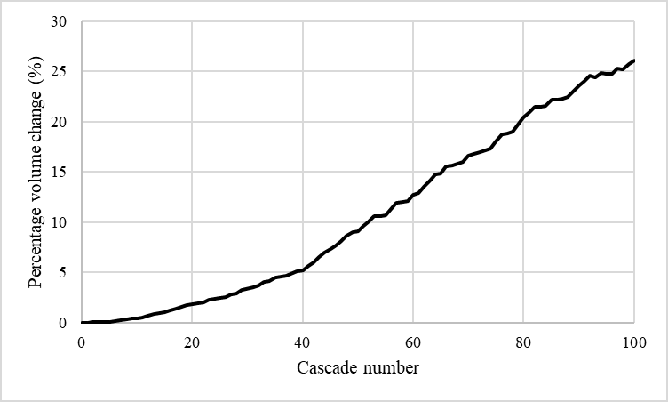
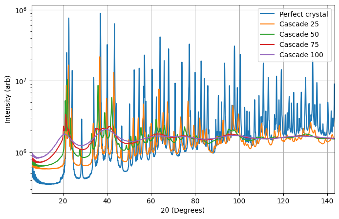

# Radiation damage in silicon carbide: molecular dynamics

Molecular dynamics simulations of radiation damage in 6H silicon carbide, a candidate shielding material for fusion breeder blankets. The project was carried out by Group 4 of the Nuclear Industrial Training Programme at the University of Sheffield, working with UKAEA (January 2026).

Half of the group irradiated SiC samples with 1.45 MeV neon ions; this code is the modelling half, which simulated a comparable damage dose in LAMMPS and compared the predicted swelling and X-ray diffraction against the experiment.

## What the simulation does

1. **Builds and thermalises the crystal** (`01_simulation/therm_in.lammps`). A 12-atom 6H-SiC unit cell is replicated 80 × 80 × 7 into a 537,600-atom supercell, then brought to 600 K and zero pressure in the NPT ensemble.
2. **Runs overlapping collision cascades** (`01_simulation/casc.py` and `casc_template.lammps`). Each cascade gives a randomly chosen atom (the primary knock-on atom) a 2 keV recoil energy in a random direction, converting energy to speed from that atom's mass. The cascade runs at constant energy with an adaptive timestep, followed by a short NPT cool-down. Each cascade restarts from the previous one, so damage accumulates.
3. **Measures swelling** (`02_analysis/volumechange.py`). Reads the cell volume from the dump file written after each cascade and reports the percentage volume change.

Interatomic potentials: a Tersoff-type potential for SiC (`2005_SiC_I.tersoff`, used for the results), with the 1994 Tersoff parameterisation (`1994_SiC.tersoff`) kept for comparison. Each file's header gives its source.

## Results



Simulated swelling rose to about 28% at the analytically estimated damage level (82 cascades).



Predicted X-ray diffraction patterns: the sharp crystalline peaks broaden into amorphous humps as damage accumulates.

The simulation predicted far more swelling than was measured, and amorphised much sooner. The likely causes are the potential's suitability for amorphised SiC, the amorphous-target assumption in the SRIM damage estimate, periodic boundaries with no free surface to relieve strain, the absence of thermostat layers, and an even Si/C split of knock-on atoms.

## Repository layout

```
00_original_starting_code/  starting scripts the project was built from (cubic 3C-SiC, 64,000 atoms, Tersoff/ZBL)
01_simulation/              the group's simulation: 6H-SiC structure, potentials, thermalisation and cascade scripts
02_analysis/                swelling (volume change) from the cascade dump files
docs/figures/               result figures
```

## Running it

Requirements: LAMMPS built with the `PYTHON` and `MANYBODY` packages, plus Python with `mpi4py`, `numpy` and `atomman`.

```bash
cd 01_simulation
mkdir -p dump
mpirun -np 8 python therm.py    # build and thermalise the crystal -> 0.restart
mpirun -np 8 python casc.py     # run the cascades -> dump/SiC.<n>.dump and <n>.restart

cd dump
python ../../02_analysis/volumechange.py   # swelling from the cascade dumps
```

The full 537,600-atom run needs an HPC cluster. Reduce `replicate` in `therm_in.lammps` and the cascade count in `casc.py` for a quick test.

## Credits

**Group 4, Nuclear Industrial Training Programme, University of Sheffield:** Abir Ahmed, Emma Bladen, Daniel de Mounteney, George Goldsmith, Eddie Mackintosh and Hugo Stonelake.

**Starting code:** the scripts in `00_original_starting_code/` were provided by **Ryan Elliot**, building on earlier material from **Prof Chris Race**. The original repository is no longer online, so the starting code is preserved here for reference.
